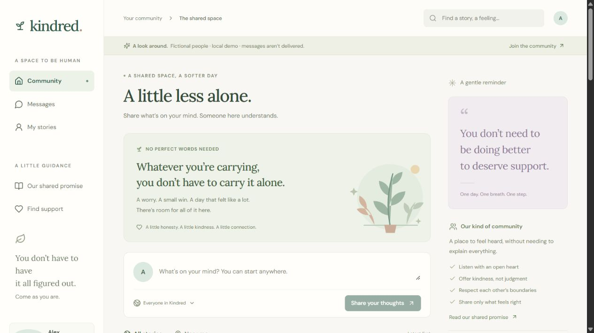

# Kindred

**A little less alone.** A mental health peer-support community where adults can share what they’re going through, listen to others, and build connections at their own pace.

[](https://github.com/JackivGarg/Kindred/actions/workflows/checks.yml)



## Features

- **Share an update** with a topic, mood, and global or regional audience.
- **Listen and respond** through replies and support reactions.
- **Connect privately** through message requests the recipient accepts first.
- **Use a nickname** instead of a real name; email stays private from members.
- **Set boundaries** by blocking members or reporting posts and messages.
- **Manage your account** with email confirmation and password recovery.

## Tech stack

| Layer                     | Technology                                   |
| ------------------------- | -------------------------------------------- |
| Frontend                  | React, TypeScript, Vite, Lucide icons        |
| Authentication & database | Supabase Auth and PostgreSQL                 |
| Access control            | Database row-level security and write limits |
| Testing                   | Vitest, React Testing Library, PGlite        |
| Deployment                | Azure Static Web Apps                        |

## Run locally

Requires **Node.js 22.12+ (22.x) or 24+** and npm.

```sh
git clone https://github.com/JackivGarg/Kindred.git
cd Kindred
npm ci
npm run dev
```

Open [localhost:3000](http://localhost:3000). Without Supabase settings, the app runs a **fictional demo**—no account needed. Sample people are fictional, messages reach no real people, and changes stay in browser session storage. Avoid entering sensitive information in the demo.

### Connect a live backend

Copy `.env.example` to `.env.local` and set your dedicated Supabase project's public values:

```dotenv
VITE_SUPABASE_URL=https://YOUR_PROJECT.supabase.co
VITE_SUPABASE_PUBLISHABLE_KEY=sb_publishable_YOUR_PUBLIC_KEY
```

Follow the [setup guide](docs/SETUP.md) for the schema, authentication, and moderator setup. Use a **separate database project**, never an unrelated existing database. Restart the development server after changing environment values.

Only public settings belong in `VITE_` variables. Keep database passwords, service-role keys, and SMTP credentials out of the frontend and repository.

## Useful commands

| Command                | Purpose                                              |
| ---------------------- | ---------------------------------------------------- |
| `npm test`             | Run component, repository, and database-policy tests |
| `npm run build`        | Check TypeScript and build the production app        |
| `npm run preview`      | Preview the production build locally                 |
| `npm run format:check` | Check code formatting                                |
| `npm run check:bundle` | Check the JavaScript size budget after building      |
| `npm run test:live`    | Run read-only checks against the configured backend  |

## Deployment

Follow the [Azure deployment guide](docs/DEPLOY.md) to prepare a dedicated Free Static Web App, configure the final app URL, and deploy. A manual GitHub Actions deployment workflow is also included.

Before opening registration, configure [signup and recovery email](docs/EMAIL-SETUP.md), verify real email links on the deployed domain, and review the [launch checklist](docs/LAUNCH.md). Running locally does not create Azure resources.

## Privacy & current scope

Kindred is an **adults-only peer-support pilot**, not professional care or an emergency response service. A human moderator must operate the reporting queue.

Posts are visible to signed-in members. Regional filters help discovery; they do not create private rooms. Nicknames provide pseudonymity, not guaranteed anonymity. Direct messages have database access controls but are **not end-to-end encrypted**; privileged operators can access stored content.

The inbox shows up to 100 conversations and the latest 200 messages per conversation; block management displays up to 500 members. Older-history navigation, automatic account deletion, and data export are not yet available. Passing tests does not establish production capacity or email delivery.

## Project structure

| Location          | Contents                                               |
| ----------------- | ------------------------------------------------------ |
| `src/components/` | Feed, posting, messaging, and account screens          |
| `src/lib/`        | Authentication, data access, validation, and demo data |
| `supabase/`       | Schema, upgrades, policies, and email templates        |
| `tests/`          | Automated checks                                       |
| `scripts/`        | Deployment and verification tools                      |
| `docs/`           | Setup, launch, performance, and verification guides    |

For measurements and known limits, see [performance notes](docs/PERFORMANCE.md), [300-member launch preparation](docs/LOAD-READINESS.md), and the [verification record](docs/VERIFICATION.md).
